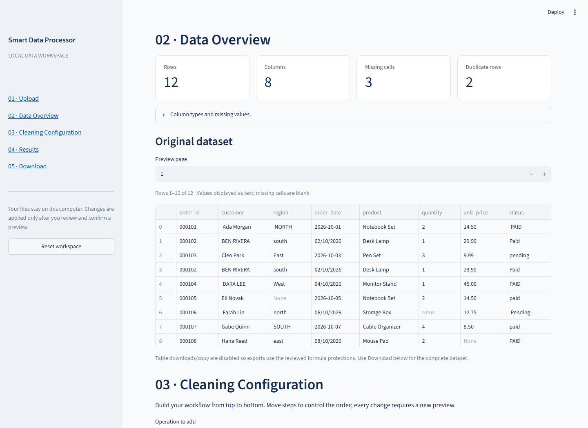

# Smart Data Processor

**Inspect, clean, preview and export CSV/Excel data locally.**

Smart Data Processor is a Python application with a Streamlit dashboard and a
reusable processing engine. It helps turn inconsistent spreadsheet data into a
reviewed dataset through explicit, ordered cleaning steps. Original data stays
unchanged, and the interface requires confirmation before preparing cleaned exports.

This is a personal portfolio project. It runs on your computer without an account,
paid API, database or cloud service; it is not presented as a production deployment
or commercial client engagement.



[Demo walkthrough](docs/portfolio/demo_workflow.md) ·
[Detailed user guide](docs/user_guide.md) ·
[Architecture](docs/architecture.md) ·
[Portfolio materials](docs/portfolio/README.md)

## What it does

- **Validated CSV/XLSX import:** encoding and delimiter controls, worksheet selection,
  selectable Excel regions, header previews and explicit repair options.
- **Data profiling:** row/column counts, pandas data types, missing values and exact
  duplicates, alongside a paginated original-data preview.
- **Configurable cleaning:** duplicate handling; keep/drop/constant/mean/median/mode
  missing-value operations; whitespace/case cleanup; optional column-name normalization.
- **Explicit conversion:** configurable numeric separators and date formats. Invalid
  or ambiguous values remain available with diagnostics; day/month order is not guessed.
- **Ordered workflows:** add/reorder operations, inspect before/after results, then
  confirm. Changing the input or configuration invalidates outdated previews and downloads.
- **Complete exports:** CSV, XLSX and structured JSON reports, with formula-injection
  protection and documented Excel limitations.

## Technology

| Layer | Implementation |
| --- | --- |
| Language | Python 3.11+ |
| Processing | pandas; standard-library Decimal for exact numeric conversion |
| Excel I/O | openpyxl |
| Interface | Streamlit, with session-local state |
| Verification | pytest, Streamlit AppTest, generated-file inspection |

The engine is independent of Streamlit. There is no external processing API,
Plotly dependency, database or automatic cloud upload.

## Install and launch

Download or clone this repository, then open a terminal in its root directory.
Create an isolated environment and install the UI and test dependencies:

**Windows PowerShell**

```powershell
python -m venv .venv
.\.venv\Scripts\python.exe -m pip install -r requirements.txt
.\.venv\Scripts\python.exe -m streamlit run app.py
```

**macOS / Linux**

```bash
python3 -m venv .venv
.venv/bin/python -m pip install -r requirements.txt
.venv/bin/python -m streamlit run app.py
```

Open **http://127.0.0.1:8501**. Keep the terminal running and use `Ctrl+C` to stop.
Run from the repository root to load `.streamlit/config.toml`, which binds to
loopback, sets the upload cap and disables Streamlit usage telemetry. For the
engine alone, install with `python -m pip install -e .` instead.

## Try the demonstration

The [fictional sales dataset](sample_data/portfolio_sales_raw.csv) includes missing
values, duplicates, whitespace/case inconsistencies and mixed ISO/day-first dates.

1. Upload `sample_data/portfolio_sales_raw.csv` and select **Load dataset**.
2. Inspect the overview: **12 rows, 8 columns, 3 missing cells, 2 duplicate rows**.
3. Follow the [seven-step configuration](docs/portfolio/demo_workflow.md): trim,
   lowercase, deduplicate, convert numbers, fill numeric medians, fill the missing
   region, and standardize dates using explicit formats.
4. Select **Preview changes**, review original/result tables and the report, then
   explicitly apply the reviewed changes.
5. Select **Prepare downloads** and download CSV, XLSX and JSON. The result has
   **10 rows, 8 columns, no missing cells and no duplicate rows**.

These are reproducible fixture results, not measured business improvements.
The chosen median and constant fills are explicit demonstration choices. Check the
[expected CSV](sample_data/portfolio_sales_expected.csv) or reproduce it using the
same engine without the interface:

```powershell
.\.venv\Scripts\python.exe scripts/run_portfolio_demo.py
```

Artifacts go to ignored `.demo-output/`; the raw input is never overwritten.
On macOS/Linux, substitute `.venv/bin/python`. Other fictional examples are listed
in [sample_data/README.md](sample_data/README.md).

## Excel formulas and export safety

**Flat XLSX exports are new data tables, not preserved workbooks.** They do not
retain working formulas, original formatting, merged cells, charts or other sheets.
Imported formulas are never evaluated or silently replaced with cached results.

Formula-bearing data requires explicit acknowledgment before flat CSV/XLSX export.
Expressions become **protected, non-executable text**; XLSX adds explanatory notes.
References retain their original meaning and are neither translated nor validated:
referenced cells may have moved or been omitted. For example, selecting `K6:N9`
moves source `N7` to exported `D2`, but `=L7+M7` remains text rather than a claimed
working calculation. The **unchanged original-workbook download** preserves the
original bytes and formula definitions, without applying cleaning changes.

CSV formula-like text receives an apostrophe. XLSX stores all text explicitly as
strings and stores Decimal/large integers as text when needed to preserve precision.
Those representation changes are reported; unsupported cells fail rather than being
silently truncated. See [the export contract](docs/user_guide.md#safe-spreadsheet-exports).

## Project structure

```text
app.py                         Streamlit entry point
src/smart_data_processor/       Import, profiling, cleaning, pipeline and exports
  dashboard.py                 Interface and widget wiring
  dashboard_state.py           Session lifecycle and configuration adapters
sample_data/                   Clearly labeled synthetic inputs and expected output
scripts/                       Reproducible demo and performance benchmark
tests/                        Engine, state, UI and regression tests
docs/
  user_guide.md                Detailed behavior and Python API examples
  architecture.md              Decisions, contracts and tradeoffs
  portfolio/                   Upwork copy, demo script and release checklist
  screenshots/                 Real application captures and their provenance
```

## Testing and evidence

Run the complete suite in the installed environment:

```powershell
.\.venv\Scripts\python.exe -m pytest -q
```

Use `.venv/bin/python -m pytest -q` on macOS/Linux. Tests cover non-mutation,
malformed inputs, formula safety, missing/duplicate headers, pipeline ordering,
preview invalidation, confirmation and exports. The portfolio demo is also checked
against recorded expected values, and the copy's length constraints are validated.

- [Current release checks](docs/portfolio/release_checklist.md): exact test results,
  screenshot provenance and pending publication decisions.
- [Phase 4 validation](docs/phase4_validation.md): historical test outcomes and local
  performance observations, with [reproducible benchmark code](scripts/benchmark_phase4.py).
- [Screenshot verification scope](docs/portfolio/screenshots.md): what was actually
  captured and what still needs manual checking.

No full OS/Python/dependency compatibility matrix or production load test is claimed.

## Known limitations

- Defaults: **10 MiB upload**, **100 MiB expanded XLSX archive**, and **2,000,000
  worksheet cells including blanks**. The grid limit applies even to small selected
  ranges; the dashboard inspects all sheets. Oversized sheets are rejected, not truncated.
- Processing, copies and exports consume memory and run synchronously. These limits
  do not guarantee peak RAM or responsiveness for every workbook.
- CSV loads as text to preserve identifiers; numeric/date conversion is explicit.
  The displayed `object` dtype is not proof that values share one semantic type.
- Region detection suggests geometric rectangles, not guaranteed logical tables.
  Unrelated tables are not combined by default. Formula translation is unsupported.
- Session loss/reset/restart discards working state. There are no persistent projects,
  accounts, background jobs or multi-file joins. Table previews use 100-row pages;
  reviewed downloads contain the complete result.
- Numeric/categorical distributions and automatic format-inconsistency diagnostics
  from the original proposal remain future work.

## Documentation and publication status

The [project proposal](PROJECT_PROPOSAL.md) records the original specification;
implementation details and limitations are documented in the current guides.
Development used OpenAI Codex assistance. Portfolio materials describe this as a
personal project and make no claims of paying customers or commercial deployment.

Publication is **not yet approved**. Review the [release checklist](docs/portfolio/release_checklist.md):
the user cleared the tracked regression workbook for public redistribution on
2026-10-29, but repository license selection remains pending. No code or assets have been pushed or
published automatically. A public repository alone does not establish a reuse license.
